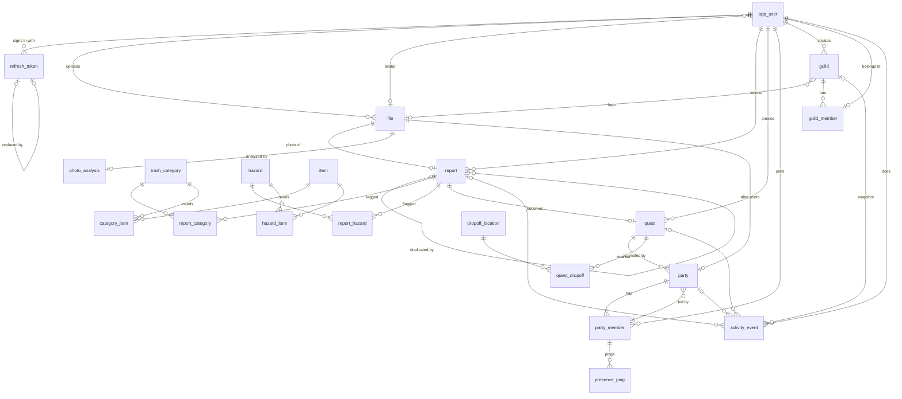
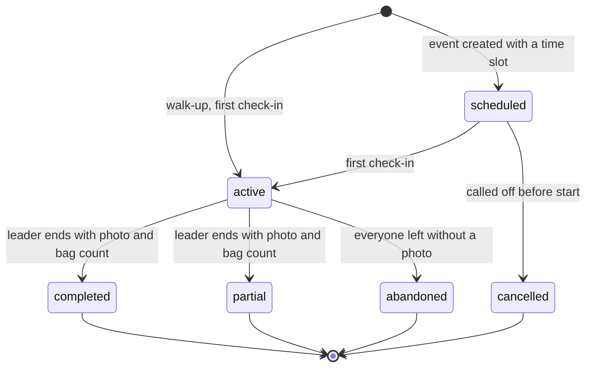

# CleanPursuit database design

The database is a Tiger Cloud service running Postgres 18 with TimescaleDB, PostGIS, H3 and citext.
It has 21 tables, 2 of which are hypertables, plus 4 continuous aggregates and 1 view.
The source of truth is the SQL in `server/db/migrations/`; this file explains the shape and the reasons behind it.

For the product side, see [mvp.md](mvp.md).

## Environment

| What | Value |
| --- | --- |
| Service | `clean-pursuit` (id `sm60nzjanh`), DEV, us-east-1 |
| Postgres | 18.6, with built-in `uuidv7()` |
| Extensions | TimescaleDB 2.30, PostGIS 3.6, h3 + h3_postgis 4.2 (pulls in postgis_raster), citext |
| Applied | `001_initial_schema.sql` to `009_analysis_titles.sql` |
| Credentials | Connection string stored in Infisical, never in the repo |

## Conventions

- Every surrogate key is `uuid DEFAULT uuidv7()`, so ids sort by creation time.
- Lookup tables (`trash_category`, `hazard`) use a short text `code` as the key.
- Mutable tables have `created_at` and `updated_at`, with a `set_updated_at()` trigger.
- Status columns are Postgres enums, and CHECK constraints keep each status consistent with its timestamps and fields.
- Usernames, emails and guild names are `citext`, so uniqueness ignores case.
- Locations are `geography(Point, 4326)` with GiST indexes.
- Applied migrations are never edited.
  Changes go in a new numbered migration.

## Relationship diagram

Arrows read from the one side to the many side.
Snapshot links from `activity_event` are included.



## Tables

### Users, auth and files

| Table | Purpose |
| --- | --- |
| `app_user` | One row per account. Holds `username`, `email`, the argon2id `password_hash`, an optional avatar, and `total_xp` (the all-time leaderboard). |
| `refresh_token` | Refresh tokens for JWT auth. Stores only a hash. `replaced_by_id` chains rotations so token reuse can be detected and the chain revoked. |
| `file` | One row per object in Cloudflare R2: `key`, `content_type` (images only), `size_bytes`, uploader. Owners point at files; files never point at owners. The API writes a row only after checking the uploaded object. |

### Reports and tags

| Table | Purpose |
| --- | --- |
| `report` | One user's sighting: photo, description, location, an optional `place_name` (a readable name for the spot, shown instead of coordinates), `difficulty_tier`, and an optional trash volume range (`estimated_volume_min_gallons`, `estimated_volume_max_gallons`). `area_id` is generated from the location. `estimated_bag_count` is no longer written and will be dropped. |
| `report_category` | Trash categories on a report, with `source` (`user` or `gemini`). |
| `report_hazard` | Hazard flags on a report, with `source`. |
| `photo_analysis` | Gemini's suggestions for one uploaded photo, keyed by `file_id`: whether it shows litter, a quest title, a description, category and hazard codes, a trash volume range in gallons and `terrain`, plus the model, token counts and latency. |

Gemini runs once per photo, before the report exists, and its result prefills the report form.
The reporter confirms or edits the tags, and a tag on the report has `source = 'gemini'` when Gemini suggested it for that photo and the reporter kept it.
`photo_analysis` keeps the codes as plain arrays because a row is a snapshot of what the model said; the API only lets Gemini pick codes that exist at the time.
The token counts and latency are there to compare models on cost and speed.

Duplicate rules, enforced by triggers:

- Re-reporting a known spot creates a new `report` row whose `duplicate_of_report_id` points at the original.
- A duplicate always points at an original, never at another duplicate (one level deep).
- A report that has duplicates, or has a quest, cannot become a duplicate.
- Only an original report can become a quest.

`GET /files/{id}/report` lets the uploader recover the report attached to their confirmed photo after a lost response.
It returns null when the photo has no report, and does not allow another user to look up that upload.
No additional recovery columns are stored.

`area_id` is `h3_lat_lng_to_cell(location, 10)`, a hexagon with an edge of about 75 m.
It is a stored generated column, so it can never disagree with the location.

`difficulty_tier` is set by API rules from the report's tags, not by Gemini directly.
It is provisional until a party ends, when the leader can correct the tags.

### Quests and parties

| Table | Purpose |
| --- | --- |
| `quest` | The problem to clean up, created from one original report (`report_id` is unique). `created_by_user_id` is the person raising awareness, not an organizer. Status: `open`, `completed`, `cancelled`, `expired`. |
| `party` | One attempt at a quest. `scheduled_start`/`scheduled_end` set means an event; both null means a walk-up on a bounty. Ends with `after_photo_file_id` and `bag_count`. |
| `party_member` | A user in a party: sign-up, check-in, last on-site time, and how they left. |

Party rules enforced in the database:

- `leader_user_id` is required and must be a member of the party (a deferred composite FK to `party_member`, so both rows can be inserted in one transaction).
- Only one active walk-up party per quest, so walk-ups join the live party instead of starting a second one.
- `scheduled` needs a schedule and no start; `active`, `partial` and `completed` need `started_at`.
- `partial` and `completed` need an after photo and a bag count; any ended status needs `ended_at`.
- A member who is `checked_in` or `left` has `checked_in_at`; a member who `left` has `left_at` and `left_reason` (`voluntary`, `geofence_timeout`, `party_ended`).

Party statuses:



Rules that live in the API, not the database:

- Scheduling the same quest, organizer and exact time slot again returns the existing scheduled or active event.
  The API locks the quest row while checking and inserting, so concurrent retries create one party and one organizer membership.

- Check-in needs a signed-up member, a scheduled party inside its time slot, an open quest and a location within 100 m of the report.
  The first check-in sets the party `active` and `started_at`.
- Walk-up check-in (`POST /quests/{id}/walk-up`) needs only an open quest and a location within 100 m.
  It locks the quest row, so concurrent first check-ins start one walk-up, and either joins the active walk-up or inserts a new `active` party with the caller as leader and member.
  A member who `left` checks in again by returning to `checked_in` with `left_at` and `left_reason` cleared, keeping `checked_in_at`.
- A walk-up member whose `last_on_site_at` (or `checked_in_at`) is more than 30 minutes old becomes `left` with `geofence_timeout`, and `left_at` is their last on-site time.
  The API applies this lazily, in its own transaction, before walk-up check-in, presence pings, leaving and ending, and quest responses ignore those members until then.
- When a walk-up's leader is no longer `checked_in`, `leader_user_id` moves to the `checked_in` member with the earliest `checked_in_at`.
  With nobody `checked_in`, the walk-up becomes `abandoned` with `ended_at` set to the last member's `left_at`.
- `presence_ping.on_site` is computed with `ST_DWithin` against the quest's report location, within 100 m, and an on-site ping updates `party_member.last_on_site_at`.
- Ending a party computes each member's time on site from `presence_ping`: the sum of the gaps between consecutive pings that were both on site, each gap at most 10 minutes, from check-in until the party ends or, for an event, its scheduled end if that is earlier.
- Ending a party marks `signed_up` members `no_show` and `checked_in` members `left` with `party_ended`.
- Ending with `completed` sets the quest `completed` and its `scheduled` parties `cancelled`.
- Not built yet for events: leaving after check-in, promoting a member when the leader leaves, and the 30-minute timeout.

### Equipment lookup

| Table | Purpose |
| --- | --- |
| `trash_category` | Fixed category list, seeded: plastic, paper, glass, metal, organic, textiles, electronics, mixed. |
| `hazard` | Fixed hazard list with `warning_text` and `requires_dropoff`, seeded: sharps, biohazard, broken_glass, chemicals, bulky_items. |
| `item` | A piece of gear, such as gloves or grabbers. `005` seeds a sharps container; `007` seeds a litter grabber, work gloves, heavy-duty trash bags, puncture-resistant gloves and closed-toe shoes. |
| `category_item` | Gear needed for a category. `007` maps the grabber and gloves to every category, and trash bags to every category except electronics. |
| `hazard_item` | Gear needed for a hazard. `required` marks gear volunteers must bring. `005` maps the sharps container to `sharps` as required; `007` maps puncture-resistant gloves and closed-toe shoes to `broken_glass`. |

The gear list for a quest is derived by joining its report's tags to these tables, so Gemini is never called again for gear.
Required hazard gear is always listed, first.
Beyond that, a report with hazards gets only hazard gear, and gets none if any of its hazards has no gear mapped.
A report with a hazard that has `requires_dropoff` gets only its required gear, plus warnings.
Sharps and biohazard warnings recommend calling 311 and warn volunteers to be extremely careful if they handle it themselves; they never give step-by-step handling instructions.

### Drop-off locations

| Table | Purpose |
| --- | --- |
| `dropoff_location` | Sharps and biohazard drop-off sites. `open_data` rows come from an official dataset (NYC Open Data's syringe drop-off sites), keyed by `external_id`, with phone, hours and notes; `verified_at` is the dataset's last update. `seed` rows are hand-verified. Both carry name, address and location. `google_places` rows store only `google_place_id`, because Places terms limit caching; the API refetches details. |
| `quest_dropoff` | The nearest drop-offs for a quest, fetched once, with `distance_m` and `rank`. `quest.dropoffs_fetched_at` records that the lookup ran, even if it found nothing. |

The API fills `quest_dropoff` the first time a quest with a `requires_dropoff` hazard asks for drop-offs.
It saves up to 5 active `accepts_sharps` sites within 5 km, nearest first.
Listed sites (`open_data` and `seed`) come first, and Google Places is searched only when none is nearby.
If the Places search fails, nothing is saved, so the next request tries again.

`npm run import:dropoffs` in `server/` loads the NYC dataset and can be run again: rows update in place, and sites that left the dataset get `retired_at` instead of being deleted, because saved quest lists still point at them.
Retired sites are hidden from lookups and from saved lists.

### Guilds (not in the MVP)

| Table | Purpose |
| --- | --- |
| `guild` | A team with a name, description, logo and creator. |
| `guild_member` | Membership with a role (`owner` or `member`). `user_id` is unique, so a user is in at most one guild. |

The tables exist so `activity_event.guild_id` can be captured from day one.
There are no guild features in the MVP.

### Hypertables

| Table | Purpose |
| --- | --- |
| `activity_event` | Append-only log of everything that happened. Source for XP, leaderboards, hotspots and the dashboard. 7-day chunks, segmented by `user_id`, compressed after 7 days. Primary key `(id, occurred_at)`. |
| `presence_ping` | GPS pings from checked-in members during a party; time on site for XP is computed from them. 1-day chunks, segmented by `party_id`, compressed after 1 day, dropped after 30 days for privacy. |

The compression policies were not written out in `001`.
TimescaleDB adds them because the tables are created with `tsdb.hypertable` and a `segmentby`, using the chunk interval as the delay.
Compressed chunks still accept inserts, updates and deletes.

`activity_event` kinds:

| Kind | Meaning | Required fields |
| --- | --- | --- |
| `report_submitted` | A report was filed | `report_id`, `area_id` |
| `party_checked_in` | A member checked in | `party_id` |
| `party_left` | A member left | `party_id` |
| `party_ended` | The leader ended the party (one row per party) | `party_id`, `bag_count` |
| `party_xp_awarded` | XP for one checked-in member | `party_id`, `minutes_on_site` |
| `quest_completed` | A quest was completed | `quest_id` |
| `hotspot_bonus` | Bonus XP for cleaning a hotspot | |
| `xp_adjustment` | Manual correction; the only kind that may carry negative XP | |

`guild_id` and `area_id` are snapshots taken when the event happens.

## Leaderboards and hotspots

All aggregates are real-time (`materialized_only = false`) and bucket in UTC.

| Object | Kind | Built from | Refresh |
| --- | --- | --- | --- |
| `xp_daily_by_user` | Continuous aggregate | `activity_event` | Every 5 min, last 3 days |
| `xp_weekly_by_user` | Continuous aggregate | `xp_daily_by_user` | Every hour, last 3 weeks |
| `xp_monthly_by_user` | Continuous aggregate | `xp_daily_by_user` | Every hour, last 3 months |
| `report_daily_by_area_reporter` | Continuous aggregate | `activity_event` (`report_submitted`) | Every 5 min, last 3 days |
| `area_hotspot_30d` | Plain view | `report_daily_by_area_reporter` | Always current |

- XP aggregates carry `xp`, `minutes_on_site` and `parties` per user per bucket, indexed on `(bucket, xp DESC)`.
- All-time XP is `app_user.total_xp`, and the all-time leaderboard ranks it.
  The pending `008_leaderboard_index.sql` adds an index on `(total_xp DESC, username)`.
- The daily, weekly and monthly leaderboards read the current UTC bucket from the matching aggregate.
  The current week and month are never materialized yet, so their rows are rolled up from `xp_daily_by_user` when read.
  The API filters on a range of fixed timestamps rather than `bucket = time_bucket(..., now())`, so TimescaleDB pushes the filter down to the bucket index.
- `GET /leaderboards` also counts users with more XP than the caller across the full period to return their personal rank independently of the list limit.
  It uses the same aggregate and UTC bounds as the list, and returns a null rank when the caller's net period XP is zero or negative.
- A user's level is derived from `total_xp` in the API and is not stored (see [Levels](mvp.md#levels)).
- `area_hotspot_30d` returns `distinct_reporters`, `reports` and `last_reported_day` per `area_id` for the last 30 days.
- The heat map and the hotspot bonus use `distinct_reporters`, so one person re-reporting a spot cannot heat it up alone.
- The bonus threshold lives in the API: 3 or more distinct reporters.
- The planned dashboard will group areas with `h3_cell_to_parent(area_id, 7)` instead of a neighborhoods table.

Refresh policies only look back a few days.
After backfilling seed data, refresh the full range by hand, daily first:

```sql
CALL refresh_continuous_aggregate('xp_daily_by_user', NULL, NULL);
CALL refresh_continuous_aggregate('xp_weekly_by_user', NULL, NULL);
CALL refresh_continuous_aggregate('xp_monthly_by_user', NULL, NULL);
CALL refresh_continuous_aggregate('report_daily_by_area_reporter', NULL, NULL);
```

## Open items

- Seed a few months of backdated demo data for New York City.
- Add a dashboard aggregate; every party event already carries `area_id`.
- Drop `report.estimated_bag_count` once no deployed code reads it (kept in 004 so older branches still work on DEV).
- Clean up R2 objects that were uploaded but never confirmed, and `file` rows that were never attached to anything.
- Guild leaderboard, later.
- Verify Tiger's TLS certificate in the API by trusting Timescale's CA.
  For now the API reads `sslmode=require` the way `psql` does, so the connection is encrypted but the certificate is not checked.
