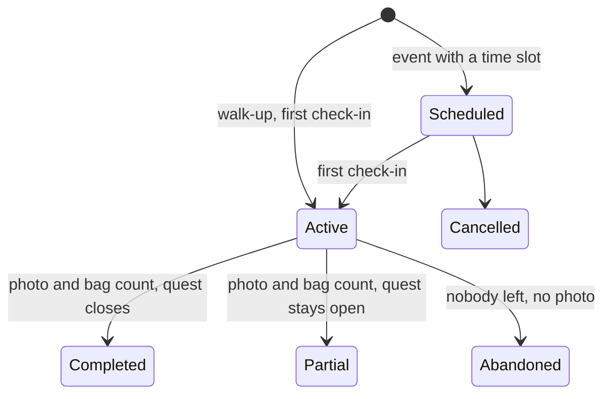

# CleanPursuit MVP

CleanPursuit is a community cleanup app built for the 48-hour Hack Knight hackathon.
People report litter, rally others to clean it up, and earn XP on leaderboards so cleanup becomes a habit.

For the database, see [database.md](database.md).

## Vision

Core question: does making litter cleanup both competitive and community-based get people to clean up their neighborhoods more often?

There are no payments.
Cleanups are volunteer events, which removes the fraud and verification problem that cash rewards would create.

## Tracks targeted

| Track | How the project qualifies | Depends on |
| --- | --- | --- |
| Best Environmental Hack | Gamified neighborhood litter cleanup | Core loop |
| Best Use of Gemini API | Photo analysis for categories, hazards and difficulty tier | Should have |
| Best Use of Tiger Data | Hypertables, continuous aggregates for hotspots and leaderboards, PostGIS, H3 | Should have |
| Best Health Hack | Hazard warnings, a 311 disclaimer, required sharps gear and drop-off routing from NYC's official site list | Should have |
| Best Overall Hack | Full loop working with a populated demo | All of the above |
| Best Domain Name (GoDaddy Registry) | Register a project domain | Stretch |
| Best Use of ElevenLabs | Spoken safety briefing | Stretch |

Solana and Presage are skipped because they do not fit a no-payments volunteer app.
Confirm in the track rules that one project can enter multiple tracks.

## Scope

### Must have: the core loop

The demo works end to end with these six features.

1. Report an area with a photo, location and description.
2. Create a quest from a report.
3. Browse quests and parties in a scrollable list and on a map.
4. Sign up for a scheduled party, or walk up and join one.
5. The party leader ends the party with a bag count and an after photo.
6. Award XP when the party ends and show a leaderboard.

### Should have: what wins tracks

- **Gemini photo analysis.**
  One call per report photo, made right after upload, before the report is sent.
  Gemini returns structured JSON: whether the photo shows litter, a suggested quest title and description, trash categories from a fixed list, hazard flags, a trash volume range and terrain.
  The report form opens prefilled, the reporter confirms or edits it, and our own rules map the tags to a difficulty tier: easy, medium, hard or legendary.
- **Equipment and warnings lookup.**
  Tables keyed by trash category and hazard, so Gemini is never called again for gear lists.
- **Hotspot multiplier.**
  Areas reported by several different people get bonus XP, computed from Tiger Data aggregates.
- **Biohazard drop-off map.**
  When a quest has sharps or biohazard, the first request for its drop-offs finds the nearest sites and saves them with the quest, so the lookup runs once.
  Sites come from NYC's official list of syringe and sharps drop-off sites first, and from a Google Places search only when none is within 5 km.
  Places results are marked unverified, so volunteers call ahead.
  They show on their own map, and tapping one opens directions in the user's maps app.
  Every sharps and biohazard quest shows a disclaimer: the recommended approach is to call 311, and anyone who handles it themselves must be extremely careful.
  A sharps container is required gear for sharps, because drop-off sites only accept sharps in a rigid, puncture-proof container.
  The app never gives step-by-step handling instructions.
- **Resources page.**
  Hardcoded in the app in `app/src/constants/resources.ts`: 311, sharps drop-off, needle-stick first aid, special waste, dumped items and DSNY's volunteer cleanup supplies.

### Stretch

- **Guilds.** Community teams with their own leaderboard. The tables exist, but there are no guild features in the MVP.
- **Before and after verification.** Gemini compares the two photos to confirm the area was cleaned before XP is awarded.
- **Researched impact ranges.** Per-quest-type estimates with cited sources. Backburnered because weight and percentage figures are hard to defend.
- **ElevenLabs safety briefing.** A spoken equipment and safety summary for volunteers.
- **GoDaddy Registry domain.** Pick a good name late in the build.

## How the core loop works

The original "event" became a quest with one or more parties.
A group gets credit together, and a cleanup can take several tries.

### Signed-out entry

- Signed-out visitors land on a mobile-first welcome screen that introduces CleanPursuit as a neighborhood cleanup adventure.
- The welcome screen explains the core loop as spotting a quest, rallying a party and cleaning up to earn XP.
- Large primary actions open account creation or login on the same route.

### Player home

- Signed-in players land on a mobile-first adventure hub that shows their total XP, current level and progress toward the next level.
- The home screen links directly to nearby quests, quest creation and the all-time leaderboard.
- Player progress uses the level values returned by the API and does not invent streaks, ranks or activity totals.

### Report

- A user submits a photo, location and description.
- The location snaps to an H3 cell (resolution 10, about 75 m edge) stored as `area_id`.
- Gemini looks at the photo as soon as it is uploaded and prefills the form with a quest title, a description, trash categories, hazards and a trash amount (see [Trash amount](#trash-amount)).
- The reporter confirms or edits the categories and any hazards, and our rules set the difficulty tier from them (see [Difficulty tier](#difficulty-tier)).
- Selecting sharps or biohazard shows a Yes/No warning before the hazard is added to the report.
  The warning tells volunteers not to pick up or touch the item and points them to drop-off and sanitation escalation information.
- If Gemini is slow or down, the form starts empty and the reporter fills it in by hand.
- If someone reports a spot that is already reported, the app tells them it exists.
  A new report is still saved and linked to the original as a duplicate.
- A spot counts as already reported when an original report within 25 m still needs work: it has no quest yet, or its quest is open.
  Once that quest is completed, cancelled or expired, a new report there starts fresh.
- Duplicates heat up the hotspot map, but only distinct reporters count, so one person cannot heat a spot alone.

### Difficulty tier

The first rule that matches sets the tier:

| Tier | When |
| --- | --- |
| Legendary | Sharps or biohazard |
| Hard | Chemicals or broken glass, or 10 or more kitchen bags of trash |
| Medium | Bulky items or electronics, or 4 or more kitchen bags of trash |
| Easy | Anything else |

The tags and trash amount are the ones the reporter submits, after Gemini's suggestions prefill the form.
Gemini never sets the tier directly, and it never adds a tag the reporter did not see.
Each tag records whether it came from Gemini or the reporter.
The tier stays provisional until a party ends, when the leader can correct the tags.

### Trash amount

A report estimates how much trash there is as a low and high volume in US gallons, such as 100-150 gallons.
A single number looked more exact than it is: two Gemini models said 15 and 25 bags for the same photo.

- Gemini suggests the range and the reporter confirms or changes it.
- The API turns the range into bag counts for common bags, so volunteers can see what to bring with the bags they have.
  For 100-150 gallons: 8-12 kitchen bags (13 gal), 4-5 large trash bags (33 gal) or 3-4 contractor bags (42 gal).
  Bag counts are arithmetic, never Gemini's guess.
- A range must be tight: the high end is at most 1.5 times the low end, or at most one kitchen bag (13 gal) above it for small piles.
  Gemini's ranges are narrowed around the same middle when they are wider, and the API rejects wider ranges from reporters.
- The tier uses a point a third of the way up the range, so it leans toward the low end and inflating the high end counts for less.
  For 104-156 gallons that point is about 9.3 kitchen bags, so the tier is medium, not hard.
- Bulky items that do not fit in a bag are left out of the volume and flagged as `bulky_items` instead.
- The range only estimates the job.
  The bags actually collected come from the party leader when the party ends.

### Quest

- An original report can become one quest: the problem to solve.
- Any signed-in user can create the quest, not only the reporter.
- The person who creates the quest is raising awareness, not organizing.
  They are asked if they want to join a party, but they do not have to.
- The Create a quest tab collects a before photo, quest title, description, confirmed categories and hazards, an optional trash-volume range, and a location with an editable place name.
  Photos are resized and converted to JPEG before uploading directly to R2.
  Gemini suggestions prefill untouched fields; manual edits are preserved if analysis finishes later.
  The reporter can continue without AI suggestions and must confirm both the report details and the cleanup coordinates before submitting.
  On phones, GPS and address lookup help pin the spot; web supports GPS or manually entered coordinates.
  Sharps and biohazard suggestions require the same Yes/No warning confirmation as manually selected hazards.
  Scheduling an initial party is optional.
  When enabled, it makes the creator the organizer and first attendee, with a future start and a duration of at most 12 hours.
  The API still saves those records in report -> quest -> party order.
- Duplicate reports are saved and linked to the original quest instead of creating a second quest.
  If the original report has no quest, the flow can create one from it.
  Scheduling on a duplicate requires reviewing the original quest and its location first.
  New hazard flags from the duplicate sighting remain visible alongside the original quest's warnings.
  Gear recommendations for the original are hidden when the new sighting adds a hazard.
- Failed requests keep the form and resume from saved records while the tab remains mounted.
  An uploader-only photo-to-report lookup recovers a report whose response was lost; reading the report recovers its quest.
  Repeating the same event time slot as its organizer returns the existing scheduled or active party.
- The saved quest summary shows the API-assigned difficulty, bag estimates, gear, hazard warnings and nearby drop-offs with directions, or sanitation escalation guidance.
- Recommended party size is not collected yet because the API does not store it.
  Parties have no sign-up limit.

### Party

A party is one attempt at a quest, and a quest can have many.
There are two kinds, derived from whether a schedule is set:

| Kind | How it starts | Leader |
| --- | --- | --- |
| Event (scheduled party) | Someone picks a time slot and asks for help | The person who scheduled it |
| Bounty (walk-up party) | Anyone at the site checks in; others join the live party | The first person to check in |

Walk-up parties are not built yet: check-in and ending both need a scheduled party.

Event rules:

- Anyone can schedule an event on an open quest, and becomes its leader (the organizer) and first attendee.
- Events start in the future and last at most 12 hours.
- Anyone can join an event until it ends, and can withdraw until they check in.
- The organizer cannot withdraw from their own event.
- Only the organizer can see attendees' email addresses.
- The API has two routes that schedule parties.
  `POST /quests/{id}/events` applies the rules above.
  `POST /quests/{questId}/parties` only needs a future start and an end after it, with no 12-hour limit, and its join route closes at the start time instead of the end.

Leader rules:

- Every party always has a leader, and the leader is always a member.
- Only the leader can end the party.
- The leader can hand the role to another member.
- If the leader leaves without handing off, the member who has been there longest is promoted.
- If nobody is left, the party is abandoned.

Only the first two rules are built.
Handing off, promotion and abandoning a party are not.

### Presence

- Members who signed up check in by GPS when they arrive, between the scheduled start and end.
- Check-in and on-site pings use a 100 m geofence around the report location.
  The number is a temporary MVP value, to revisit after end-to-end demo testing.
- The first check-in makes the party active.
- The app sends location pings during the party, about once a minute.
- Time on site adds up the gaps between consecutive pings that were both on site.
  A gap with an off-site ping at either end does not count, and one gap counts for at most 10 minutes, so stepping away or dropping signal does not earn time.
  Nothing counts before check-in or after the scheduled end.
  The 10-minute limit is a temporary MVP value, to revisit with the ping rate after demo testing.
- Removing a member after 30 minutes without an on-site ping is not built yet.
- Pings are deleted after 30 days.

### Ending a party

The leader submits an after photo, a bag count and an outcome.
The after photo must be the leader's own confirmed upload and not attached to a report or another party.
Only an active scheduled party with an open quest can be ended.
Members who never checked in are marked as no-shows, and everyone still checked in leaves with the party.
Letting the leader correct the report's tags before XP is awarded is not built yet.

| Outcome | What happens to the quest | XP |
| --- | --- | --- |
| Completed | Closes | Yes |
| Partial | Stays open for a follow-up scheduled party or as a bounty | Yes |
| Abandoned | Stays open; everyone left without an after photo | No |
| Cancelled | A scheduled party was called off before it started | No |

The API accepts `completed` and `partial`; abandoned and cancelled have no route yet.

### XP

- XP is awarded once per party, when the leader ends it with an after photo.
- Only members who checked in earn XP, including people who left early.
- Each member's XP is based on how much of the time slot they were on site.
- XP does not scale with the difficulty tier yet.
- A member earns at most 100 XP per party, hotspot bonus included.
- Cleaning a hotspot adds bonus XP when the outcome is completed.
- XP feeds daily, weekly and monthly aggregates plus each user's all-time total, and the API serves a leaderboard for each.

| Rule | Value |
| --- | --- |
| Time slot used | The scheduled length in whole minutes, at least 1 and at most 100 |
| Base XP | 100 x minutes on site / time slot used, rounded down, at most 100 |
| Hotspot threshold | 3 or more distinct reporters in the area in the last 30 days |
| Hotspot bonus | 20% of base XP, rounded down, limited so base plus bonus is at most 100 |

For a time slot of 100 minutes or more, that is 1 XP per minute on site up to 100.
For a 1-hour slot, a member there the whole hour earns 100 XP and one there 30 minutes earns 50.
A member who earns the full 100 base XP gets no hotspot bonus, because the bonus cannot push the total past 100.

The event card's "up to" figure comes from `server/src/lib/xp.ts` (100 XP per hour on site, times easy 1x, medium 1.5x, hard 2x or legendary 3x, capped at 3 hours).
That is not what ending a party awards, so the card can show more XP than members receive.

The Leaderboard tab uses `GET /leaderboards` to show daily, weekly, monthly and all-time XP, with all time selected initially.
Days, weeks and months use the current UTC period, and weeks start on Monday.
The board shows the top 100 users with positive XP in that period, and equal XP shares a rank.
The signed-in user's rank and period XP appear even when they are outside the top 100; zero or negative period XP means they are unranked.
Daily, weekly and monthly views also show the user's all-time XP separately.
Opening the tab or pulling to refresh loads current results, and a failed refresh keeps the last loaded results with a retry message.
The older `GET /leaderboard` endpoint remains available for all-time rankings that include zero-XP accounts.

### Levels

Levels come from a user's all-time XP, so they are computed by the API and never stored.
There are 15 levels.
Going from level 1 to 2 takes 1,000 XP, and each level after takes 1.2 times the one before, rounded to the nearest 100 XP.
The last level costs about ten times the first, and reaching level 15 takes 59,200 XP in total.
The numbers live in `server/src/lib/levels.ts`.

| Level | XP to reach it | XP this level takes to finish |
| --- | --- | --- |
| 1 | 0 | 1,000 |
| 2 | 1,000 | 1,200 |
| 3 | 2,200 | 1,400 |
| 4 | 3,600 | 1,700 |
| 5 | 5,300 | 2,100 |
| 6 | 7,400 | 2,500 |
| 7 | 9,900 | 3,000 |
| 8 | 12,900 | 3,600 |
| 9 | 16,500 | 4,300 |
| 10 | 20,800 | 5,200 |
| 11 | 26,000 | 6,200 |
| 12 | 32,200 | 7,400 |
| 13 | 39,600 | 8,900 |
| 14 | 48,500 | 10,700 |
| 15 | 59,200 | Max level |

The curve was tuned for a typical cleanup earning a few hundred XP, so a regular volunteer would reach the middle levels in a few months and level 15 would take well over a hundred cleanups.
Parties now award at most 100 XP, so level 15 takes at least 592 cleanups.
Revisit the curve or the XP rules so they agree.
XP keeps counting past level 15 for the leaderboards.

## Tiger Data features

- **Activity log.** One append-only hypertable records reports, check-ins, party ends, XP and bonuses, with `user_id`, `guild_id` and `area_id` on every row.
- **Presence pings.** A second hypertable stores GPS pings with a 30-day retention policy.
  Time on site for XP is computed from these pings when a party ends.
- **Compression.** Both hypertables move older chunks to compressed columnar storage: activity after 7 days and pings after 1 day.
- **Leaderboards.** A daily continuous aggregate, with weekly and monthly rolled up from it, serves the daily, weekly and monthly leaderboards. All-time XP is a column on the user.
- **Hotspots.** A continuous aggregate counts reports per area and reporter; a 30-day view counts distinct reporters for the hotspot map and the hotspot bonus.
  The hotspot map is a layer on the Quests map (see [Quests map](#quests-map)).
- **Dashboard (not built yet).** Cleanups per week, bags collected, volunteer-hours, active volunteers and re-report rate, grouped by larger H3 cells instead of neighborhoods.
- **Geospatial.** PostGIS `geography`, GiST indexes and `ST_DWithin` for "near me" and the check-in geofence.

Aggregates are real-time and the daily ones refresh every 5 minutes, so the demo never lags.

## Gemini

- Model: `gemini-3.5-flash-lite`, set by `GEMINI_MODEL` and pinned to a stable version rather than a `-latest` alias.
- Use a response schema for structured output, with the category and hazard codes from the database as enums.
- Call it once per uploaded report photo and store the result in `photo_analysis`, keyed by the file.
- Never call it on page loads.
- Gemini only extracts features; the reporter confirms the tags and our rules set the tier.
- Thinking is set to low: picking from short lists needs little reasoning, and the reporter is waiting.
- Calls time out after 20 seconds, and reporting works without Gemini.

Why Flash-Lite:

- The task is classification from fixed lists plus one sentence, which Flash-Lite is built for.
- In a first test on four photos it answered in about 2 seconds, using about 1,430 input and 80 output tokens, or about $0.60 per 1,000 photos.
- Gemini 3.8 Flash costs about 2.5 times as much per input token, more until its launch pricing ends on January 1, 2027, and took 3 to 4 seconds or timed out in the same test.
- The risk is missing small hazards such as needles.
  The reporter confirms every tag, and `photo_analysis` records the model, so switching `GEMINI_MODEL` is a one-line change if a test set shows Flash-Lite missing hazards.

## Quests map

The Quests tab is a full-screen map of NYC with the quest list in a bottom sheet over it.

- Scheduled parties show as XP bubbles in their difficulty color.
- Open quests with no upcoming party show as waypoints: a diamond with a "!" in their difficulty color, like a quest giver in a game.
  Tapping one opens the quest with its photo, hazards, directions and a button to schedule the first party, which makes you its leader.
- Areas reported in the last 30 days glow like embers, and bigger when more people reported them.
  Hotspots, reported by 3 or more different people, glow brighter and slowly pulse, unless Reduce Motion is on.
  Zoomed in to street level, the glow fades and the area's H3 hexagon shows: solid for hotspots, dashed for areas still warming up.
- Quests and parties in a hotspot get a Hotspot badge, because cleaning them up earns bonus XP.
- The list shows parties first, then quests that still need a party, and a legend explains the glows.

## Directions handoff

Tapping Directions opens the user's preferred maps app, from `app/src/lib/directions.ts`.

- Android sends a `geo:` link, which opens the default maps app or asks which one to use.
- iOS cannot tell which maps app the user prefers, so it shows a menu: Apple Maps, Google Maps, and Waze when it is installed.
  Google's link opens its app when installed and the website otherwise.
  Detecting Waze needs `LSApplicationQueriesSchemes` in `app.json`, so it only shows up in a development build, not Expo Go.
- Web opens Google Maps in a new tab.

Links:

- Google Maps: `https://www.google.com/maps/dir/?api=1&destination=LAT,LNG`, plus `&destination_place_id=ID` for Places results
- Apple Maps: `https://maps.apple.com/?daddr=LAT,LNG`
- Waze: `https://waze.com/ul?ll=LAT,LNG&navigate=yes`

## Tech stack

| Layer | Choice |
| --- | --- |
| App | React Native |
| API | Node.js 24, Fastify 5, TypeScript, Zod, `pg` with plain SQL |
| Auth | Built into the API: argon2id password hashes, JWT access tokens, rotating refresh tokens |
| Database | Tiger Data (Postgres 18 with TimescaleDB, PostGIS, H3, citext) |
| File storage | Cloudflare R2 |
| Secrets | Infisical |
| AI | Gemini (Flash-class) |
| Drop-off search | NYC Open Data's syringe drop-off sites first, Google Places (New) as fallback |

## 48-hour build order

The core loop ships first so there is always a working demo.

1. Set up the project, the Tiger Data schema and the activity-log hypertable with area snapping. (Done)
2. Report and quest creation, with photo upload. (API done)
3. Map and list views, plus party sign-up and check-in. (Map and list with parties, quest waypoints and hotspots done; check-in done in the API)
4. Ending a party with bag count and after photo, then XP and the leaderboard. (Scheduled parties and leaderboards done in the API)
5. Gemini photo analysis, the tier rules and the equipment lookup. (Done in the API)
6. Hotspot aggregate and bonus XP. (Done in the API)
7. Biohazard drop-off map with directions links, and the resources page. (Drop-off list, directions and resources page done; the map needs a development build)
8. Seed a few months of backdated data for New York City. (Sharps drop-off sites imported from NYC Open Data)
9. Polish, rehearse the demo, then stretch goals if time remains.

## Risks and mitigations

| Risk | Mitigation |
| --- | --- |
| XP can be farmed with staged or exaggerated photos | Award XP only after the after photo, only to GPS-checked-in members, cap XP at 100 per member per party, treat the reporter's tier as provisional |
| Gemini misclassifies a photo | Gemini extracts features only; our rules set the tier; the party leader corrects tags before XP |
| Drop-off search returns places that do not accept sharps | NYC's official site list first, Places only as fallback, and a verify-before-you-go note on each Places result |
| Google Places terms limit caching | Store only place IDs and refetch details |
| Continuous aggregates lag during the demo | Real-time aggregates with a 5-minute refresh, plus a manual refresh after seeding |
| Gemini quota or rate limits | Check limits for the team key before the event; one call per report |

## Status and open decisions

Done:

- Schema migrations `001` to `009` are applied to the DEV Tiger service and tested.
- API: auth, photo uploads to R2, Gemini photo analysis, reports with duplicate detection and difficulty tiers, quests, events and scheduled parties with GPS check-in and presence, ending a party with XP from presence pings and the hotspot bonus, daily, weekly, monthly and all-time leaderboards, hotspots, equipment and drop-offs.
- 196 sharps drop-off sites imported from NYC Open Data.
- Region: New York City (the five boroughs) for seed data, drop-off locations, escalation contacts and the resources page.

Open:

- [x] XP numbers: up to 100 XP per party from the share of the time slot on site (see [XP](#xp)).
- [ ] Make the event card's "up to" XP and the level curve agree with the XP awarded.
- [x] Hotspot bonus XP and threshold: 20% bonus at 3 distinct reporters.
- [x] Geofence radius for check-in and on-site pings: 100 m for now.
- [ ] One set of routes for scheduling and joining parties (`/events` and `/parties` overlap).
- [ ] Walk-up parties, leader handoff, the 30-minute presence timeout, and abandoned and cancelled outcomes.
- [x] Daily, weekly and monthly leaderboards in the API.
- [x] Demo region, for seed data and drop-off locations: New York City.
- [x] Gear seed data for the equipment lookup.
- [ ] Backdated demo data.
- [ ] Dashboard aggregate.
- [ ] Task split across the team: frontend, Tiger Data and backend, Gemini integration, demo data.
