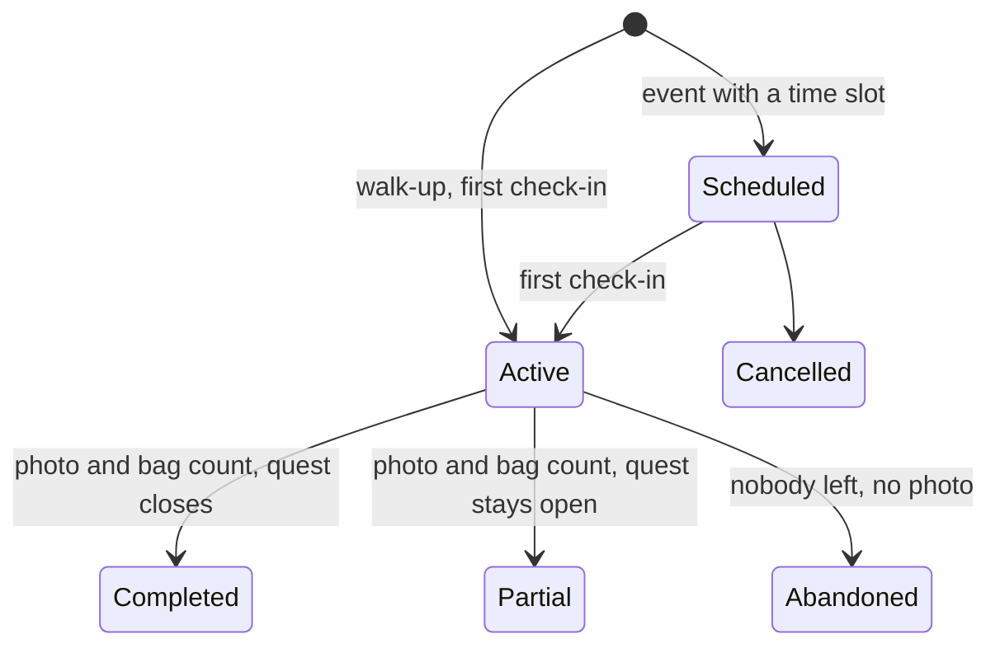

# CleanPursuit MVP

CleanPursuit is a community cleanup app built for the 48-hour Hack Knight hackathon.
People report litter, rally others to clean it up, and earn XP on leaderboards so cleanup becomes a habit.

For the database, see [database.md](database.md).

## Vision

Core question: does making litter cleanup both competitive and community-based get people to clean up their neighborhoods more often?

There are no payments.
Cleanups are volunteer events, which removes the fraud and verification problem that cash rewards would create.

## Tracks targeted

| Track | How the project qualifies | Depends on |
| --- | --- | --- |
| Best Environmental Hack | Gamified neighborhood litter cleanup | Core loop |
| Best Use of Gemini API | Photo analysis for categories, hazards and difficulty tier | Should have |
| Best Use of Tiger Data | Hypertables, continuous aggregates for hotspots and leaderboards, PostGIS, H3 | Should have |
| Best Health Hack | Hazard warnings, equipment guidance and drop-off routing for sharps | Should have |
| Best Overall Hack | Full loop working with a populated demo | All of the above |
| Best Domain Name (GoDaddy Registry) | Register a project domain | Stretch |
| Best Use of ElevenLabs | Spoken safety briefing | Stretch |

Solana and Presage are skipped because they do not fit a no-payments volunteer app.
Confirm in the track rules that one project can enter multiple tracks.

## Scope

### Must have: the core loop

The demo works end to end with these six features.

1. Report an area with a photo, location and description.
2. Create a quest from a report.
3. Browse quests and parties in a scrollable list and on a map.
4. Sign up for a scheduled party, or walk up and join one.
5. The party leader ends the party with a bag count and an after photo.
6. Award XP when the party ends and show a leaderboard.

### Should have: what wins tracks

- **Gemini photo analysis.**
  One call per report photo, made right after upload, before the report is sent.
  Gemini returns structured JSON: whether the photo shows litter, a suggested description, trash categories from a fixed list, hazard flags, a trash volume range and terrain.
  The report form opens prefilled, the reporter confirms or edits it, and our own rules map the tags to a difficulty tier: easy, medium, hard or legendary.
- **Equipment and warnings lookup.**
  Tables keyed by trash category and hazard, so Gemini is never called again for gear lists.
- **Hotspot multiplier.**
  Areas reported by several different people get bonus XP, computed from Tiger Data aggregates.
- **Biohazard drop-off map.**
  When a report is flagged as sharps or biohazard, the app fetches nearby drop-off locations once and stores them with the quest.
  They show on their own map, and tapping one opens directions in the user's maps app.
  If nothing is nearby, the app shows the sanitation escalation path instead.
  Volunteers are pointed to drop-off and escalation, never given sharps handling instructions.
- **Resources page.**
  Hardcoded in the app: sanitation escalation, disposal guidance, reporting numbers and where to get supplies.

### Stretch

- **Guilds.** Community teams with their own leaderboard. The tables exist, but there are no guild features in the MVP.
- **Before and after verification.** Gemini compares the two photos to confirm the area was cleaned before XP is awarded.
- **Researched impact ranges.** Per-quest-type estimates with cited sources. Backburnered because weight and percentage figures are hard to defend.
- **ElevenLabs safety briefing.** A spoken equipment and safety summary for volunteers.
- **GoDaddy Registry domain.** Pick a good name late in the build.

## How the core loop works

The original "event" became a quest with one or more parties.
A group gets credit together, and a cleanup can take several tries.

### Report

- A user submits a photo, location and description.
- The location snaps to an H3 cell (resolution 10, about 75 m edge) stored as `area_id`.
- Gemini looks at the photo as soon as it is uploaded and prefills the form with a description, trash categories, hazards and a trash amount (see [Trash amount](#trash-amount)).
- The reporter confirms or edits the categories and any hazards, and our rules set the difficulty tier from them (see [Difficulty tier](#difficulty-tier)).
- If Gemini is slow or down, the form starts empty and the reporter fills it in by hand.
- If someone reports a spot that is already reported, the app tells them it exists.
  A new report is still saved and linked to the original as a duplicate.
- A spot counts as already reported when an original report within 25 m still needs work: it has no quest yet, or its quest is open.
  Once that quest is completed, cancelled or expired, a new report there starts fresh.
- Duplicates heat up the hotspot map, but only distinct reporters count, so one person cannot heat a spot alone.

### Difficulty tier

The first rule that matches sets the tier:

| Tier | When |
| --- | --- |
| Legendary | Sharps or biohazard |
| Hard | Chemicals or broken glass, or 10 or more kitchen bags of trash |
| Medium | Bulky items or electronics, or 4 or more kitchen bags of trash |
| Easy | Anything else |

The tags and trash amount are the ones the reporter submits, after Gemini's suggestions prefill the form.
Gemini never sets the tier directly, and it never adds a tag the reporter did not see.
Each tag records whether it came from Gemini or the reporter.
The tier stays provisional until a party ends, when the leader can correct the tags.

### Trash amount

A report estimates how much trash there is as a low and high volume in US gallons, such as 100-150 gallons.
A single number looked more exact than it is: two Gemini models said 15 and 25 bags for the same photo.

- Gemini suggests the range and the reporter confirms or changes it.
- The API turns the range into bag counts for common bags, so volunteers can see what to bring with the bags they have.
  For 100-150 gallons: 8-12 kitchen bags (13 gal), 4-5 large trash bags (33 gal) or 3-4 contractor bags (42 gal).
  Bag counts are arithmetic, never Gemini's guess.
- A range must be tight: the high end is at most 1.5 times the low end, or at most one kitchen bag (13 gal) above it for small piles.
  Gemini's ranges are narrowed around the same middle when they are wider, and the API rejects wider ranges from reporters.
- The tier uses a point a third of the way up the range, so it leans toward the low end and inflating the high end counts for less.
  For 104-156 gallons that point is about 9.3 kitchen bags, so the tier is medium, not hard.
- Bulky items that do not fit in a bag are left out of the volume and flagged as `bulky_items` instead.
- The range only estimates the job.
  The bags actually collected come from the party leader when the party ends.

### Quest

- An original report can become one quest: the problem to solve.
- Any signed-in user can create the quest, not only the reporter.
- The person who creates the quest is raising awareness, not organizing.
  They are asked if they want to join a party, but they do not have to.

### Party

A party is one attempt at a quest, and a quest can have many.
There are two kinds, derived from whether a schedule is set:

| Kind | How it starts | Leader |
| --- | --- | --- |
| Event (scheduled party) | Someone picks a time slot and asks for help | The person who scheduled it |
| Bounty (walk-up party) | Anyone at the site checks in; others join the live party | The first person to check in |

Event rules:

- Anyone can schedule an event on an open quest, and becomes its leader (the organizer) and first attendee.
- Events start in the future and last at most 12 hours.
- Anyone can join an event until it ends, and can withdraw until they check in.
- The organizer cannot withdraw from their own event.
- Only the organizer can see attendees' email addresses.

Leader rules:

- Every party always has a leader, and the leader is always a member.
- Only the leader can end the party.
- The leader can hand the role to another member.
- If the leader leaves without handing off, the member who has been there longest is promoted.
- If nobody is left, the party is abandoned.

### Presence

- Members check in by GPS when they arrive.
- The app sends location pings during the party.
- A member with no on-site ping for 30 minutes is removed automatically.
- Time on site runs from check-in to the member's last on-site ping.
- Pings are deleted after 30 days.

### Ending a party

The leader submits an after photo, a bag count and an outcome.
The leader can also correct the report's tags before XP is awarded.

| Outcome | What happens to the quest | XP |
| --- | --- | --- |
| Completed | Closes | Yes |
| Partial | Stays open for a follow-up scheduled party or as a bounty | Yes |
| Abandoned | Stays open; everyone left without an after photo | No |
| Cancelled | A scheduled party was called off before it started | No |

### XP

- XP is awarded once per party, when it ends with an after photo.
- Only members who checked in earn XP, including people who left early.
- Each member's XP is based on their time on site.
- XP scales with the report's difficulty tier.
- XP is capped per quest so a crowd cannot farm it.
- Cleaning a hotspot adds bonus XP.
- XP feeds daily, weekly and monthly leaderboards plus each user's all-time total.

| Rule | Value |
| --- | --- |
| Base rate | 100 XP per hour on site |
| Tier multiplier | Easy 1x, medium 1.5x, hard 2x, legendary 3x |
| Cap | 3 hours on site per party |

An event card shows "up to" the XP for being on site for the whole time slot.
The hotspot bonus and threshold are still open.

### Levels

Levels come from a user's all-time XP, so they are computed by the API and never stored.
There are 15 levels.
Going from level 1 to 2 takes 1,000 XP, and each level after takes 1.2 times the one before, rounded to the nearest 100 XP.
The last level costs about ten times the first, and reaching level 15 takes 59,200 XP in total.
The numbers live in `server/src/lib/levels.ts`.

| Level | XP to reach it | XP this level takes to finish |
| --- | --- | --- |
| 1 | 0 | 1,000 |
| 2 | 1,000 | 1,200 |
| 3 | 2,200 | 1,400 |
| 4 | 3,600 | 1,700 |
| 5 | 5,300 | 2,100 |
| 6 | 7,400 | 2,500 |
| 7 | 9,900 | 3,000 |
| 8 | 12,900 | 3,600 |
| 9 | 16,500 | 4,300 |
| 10 | 20,800 | 5,200 |
| 11 | 26,000 | 6,200 |
| 12 | 32,200 | 7,400 |
| 13 | 39,600 | 8,900 |
| 14 | 48,500 | 10,700 |
| 15 | 59,200 | Max level |

The curve is tuned for a typical cleanup earning a few hundred XP, so a regular volunteer reaches the middle levels in a few months and level 15 takes well over a hundred cleanups.
Revisit it when the XP base rate is set.
XP keeps counting past level 15 for the leaderboards.

## Tiger Data features

- **Activity log.** One append-only hypertable records reports, check-ins, party ends, XP and bonuses, with `user_id`, `guild_id` and `area_id` on every row.
- **Presence pings.** A second hypertable stores GPS pings with a 30-day retention policy.
- **Leaderboards.** A daily continuous aggregate, with weekly and monthly rolled up from it. All-time XP is a column on the user.
- **Hotspots.** A continuous aggregate counts reports per area and reporter; a 30-day view counts distinct reporters.
- **Dashboard.** Cleanups per week, bags collected, volunteer-hours, active volunteers and re-report rate, grouped by larger H3 cells instead of neighborhoods.
- **Geospatial.** PostGIS `geography`, GiST indexes and `ST_DWithin` for "near me" and the check-in geofence.

Aggregates are real-time and the daily ones refresh every 5 minutes, so the demo never lags.

## Gemini

- Model: `gemini-3.5-flash-lite`, set by `GEMINI_MODEL` and pinned to a stable version rather than a `-latest` alias.
- Use a response schema for structured output, with the category and hazard codes from the database as enums.
- Call it once per uploaded report photo and store the result in `photo_analysis`, keyed by the file.
- Never call it on page loads.
- Gemini only extracts features; the reporter confirms the tags and our rules set the tier.
- Thinking is set to low: picking from short lists needs little reasoning, and the reporter is waiting.
- Calls time out after 20 seconds, and reporting works without Gemini.

Why Flash-Lite:

- The task is classification from fixed lists plus one sentence, which Flash-Lite is built for.
- In a first test on four photos it answered in about 2 seconds, using about 1,430 input and 80 output tokens, or about $0.60 per 1,000 photos.
- Gemini 3.8 Flash costs about 2.5 times as much per input token, more until its launch pricing ends on January 1, 2027, and took 3 to 4 seconds or timed out in the same test.
- The risk is missing small hazards such as needles.
  The reporter confirms every tag, and `photo_analysis` records the model, so switching `GEMINI_MODEL` is a one-line change if a test set shows Flash-Lite missing hazards.

## Directions handoff

- Google Maps: `https://www.google.com/maps/dir/?api=1&destination=LAT,LNG`
- Apple Maps: `https://maps.apple.com/?daddr=LAT,LNG`

## Tech stack

| Layer | Choice |
| --- | --- |
| App | React Native |
| API | Node.js 24, Fastify 5, TypeScript, Zod, `pg` with plain SQL |
| Auth | Built into the API: argon2id password hashes, JWT access tokens, rotating refresh tokens |
| Database | Tiger Data (Postgres 18 with TimescaleDB, PostGIS, H3, citext) |
| File storage | Cloudflare R2 |
| Secrets | Infisical |
| AI | Gemini (Flash-class) |
| Drop-off search | Hand-verified seed rows first, Google Places as fallback |

## 48-hour build order

The core loop ships first so there is always a working demo.

1. Set up the project, the Tiger Data schema and the activity-log hypertable with area snapping. (Done)
2. Report and quest creation, with photo upload. (API done)
3. Map and list views, plus party sign-up and check-in.
4. Ending a party with bag count and after photo, then XP and the leaderboard.
5. Gemini photo analysis, the tier rules and the equipment lookup. (Analysis and tier rules done in the API)
6. Hotspot aggregate and bonus XP.
7. Biohazard drop-off map with directions links, and the resources page.
8. Seed a few months of backdated data for one demo region, plus a few hand-verified sharps drop-off locations.
9. Polish, rehearse the demo, then stretch goals if time remains.

## Risks and mitigations

| Risk | Mitigation |
| --- | --- |
| XP can be farmed with staged or exaggerated photos | Award XP only after the after photo, only to GPS-checked-in members, cap XP per quest, treat the reporter's tier as provisional |
| Gemini misclassifies a photo | Gemini extracts features only; our rules set the tier; the party leader corrects tags before XP |
| Drop-off search returns places that do not accept sharps | Hand-verified seed table first, Places as fallback, and a verify-before-you-go note on each result |
| Google Places terms limit caching | Store only place IDs and refetch details |
| Continuous aggregates lag during the demo | Real-time aggregates with a 5-minute refresh, plus a manual refresh after seeding |
| Gemini quota or rate limits | Check limits for the team key before the event; one call per report |

## Status and open decisions

Done:

- Schema migrations `001` to `003` are applied to the DEV Tiger service and tested.
- API: auth, photo uploads to R2, Gemini photo analysis, reports with duplicate detection and difficulty tiers, and quests.

Open:

- [x] XP numbers: 100 XP per hour, tier multipliers and a 3-hour cap (see [XP](#xp)).
- [ ] Hotspot bonus XP and threshold.
- [ ] Geofence radius for check-in and on-site pings.
- [ ] Demo region, for seed data and drop-off locations.
- [ ] Gear seed data for the equipment lookup.
- [ ] Backdated demo data.
- [ ] Dashboard aggregate.
- [ ] Task split across the team: frontend, Tiger Data and backend, Gemini integration, demo data.
